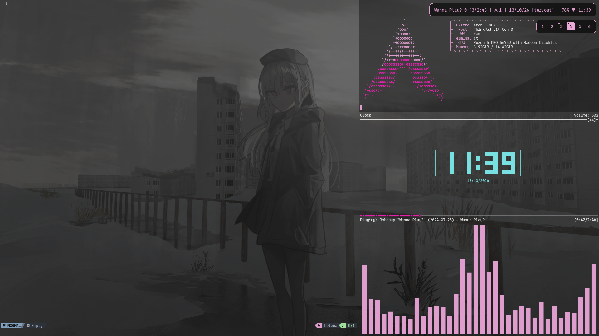

# My Desktop 

`user` folder is equivalent to ~  

Basic stuff:

- Window manager: Dwm
- - The bar is out of the way, it shows up when mod is pressed
- - Enabling Capslock disables dwm's hotkey, meaning you can use the alt key in app shortcuts
- Terminal: St
- App launcher: dmenu
- Compositor: picom

## Requirements in my .xinitrc
- Screen Temperature: redshift (my eyes hate blue)
- Brightness: light (my eyes hate bright)
- Wallpaper: xwallpaper

some things also assume that you have

- mpd  
- xvkbd  
- xdotool

## Keybinds

Default dwm keybinds  
  
All binds are made via dwm. It is a good idea to look through them since my keyboard is wonky.  
Since I do not have a numpad, there are AltGr (mod5) keybinds for those keys using xdotool.  
  
Common binds:  
Ctrl + Shift + t = St  
Ctrl + Shift + n = Paste using xvkbd  
Ctrl + Shift + space = Open menu menu (which constains all below)  
Ctrl + Shift + return = Dmenu (specifically dmenu_run)  
Ctrl + Shift + s = Power settings  
Ctrl + Shift + w = Wallpaper theme selector  
Ctrl + Shift + m = set song menu  
Ctrl + Shift + k = set playlist menu  
Ctrl + Shift + F2 = screen recoding menu  

## Wallpapers

I have a folder in ~ called `Backgrounds`. In it, there are folders named with an id (such as A) which contains a set of images for the wallpaper rotation. In here theres only the files with the image Ids.   
The wallpaper theme selector ( Ctrl + Shift + w ) allows you to pick one.   
The themes must be manually set in `~/Scripts/wallBind.sh`   
A matching color should also be set in `~/Scripts/generateColors.sh` which then creates a .xresources file to be read by dwm  
Wallpaper rotates every 300 seconds.   

## Scripts

The scripts have comments at the top saying what they do.  
